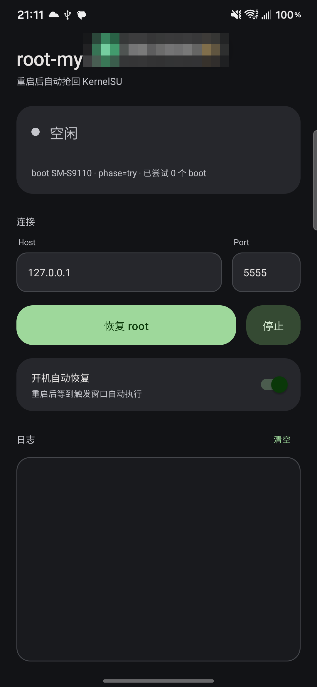

# root-my-s23

给 Samsung Galaxy S23（SM-S9110）用的 KernelSU 开机自动恢复工具：**重启后不接电脑、不插 USB，App 自己把临时 root 抢回来并加载 KernelSU。**



**开箱即用：SM-S9110 / 固件 `S9110ZHS8FZI1`（港版 TGY，One UI 8.5 / Android 16）。**
其他 S23 型号和其他固件必须自己编译 payload，见 [其他 S23 怎么自己做](#其他-s23--其他固件怎么自己做)。

---

## 为什么需要它

这台机器的 bootloader 锁死（`ro.boot.flash.locked=1`、`verifiedbootstate=green`，开发者选项里连 OEM 解锁开关都没有），刷不了 Magisk / KernelSU 的 boot 镜像。能走的只有 CVE-2026-43499 临时 root + KernelSU late-load：

1. exploit 把当前进程的 cred 改成 uid 0；
2. 用这个临时 root 把 `kernelsu.ko` 手工装进内核（`ksud --late-load`）；
3. soft-reboot 重放 services，Zygisk / LSPosed 才完整。

麻烦的是**每次重启都要重来一遍**，而且有硬窗口：

- 要开机后 **90–120s** 打。早了 tracefs 还没产出事件；晚了 allocator 碎片化，凑不齐 32 个 order-3 的 `mm_struct`。
- 一次开机**一发子弹**。`SLIDE_STACK_WRITER` 跑过之后同一次 boot 内不能再试（exploit 自己会拒绝），没中就只能重启换 boot。

本项目把这套流程做成一个前台服务：开机广播拉起 → 等窗口 → 点火 → 轮询结论 → late-load → soft-reboot → 验证 `su`。全程 3~4 分钟，不需要电脑。

---

## 直接可用的型号

`assets/payload/` 里打包的是 **`S9110ZHS8FZI1` 专用**的 exploit 二进制和物理指纹表，只适用于下表这一行。

| 型号 | 代号 | 固件版本号 | 内核 | 状态 |
| --- | --- | --- | --- | --- |
| SM-S9110（国行硬件刷港版 TGY） | `dm1q` | `S9110ZHS8FZI1` | `5.15.189-android13-8-33413713-abS9110ZHS8FZI1` | 本机实测 |

核对方法：

- 设置 → 关于手机 → 软件信息 → **版本号**，必须逐字符等于 `S9110ZHS8FZI1`；
- `adb shell uname -r` 必须逐字符等于 `5.15.189-android13-8-33413713-abS9110ZHS8FZI1`。

差一个字符都不行。`p0_fingerprint.h` 是从这一版内核的 raw `Image` 逐字节生成的，`target.h` 里的结构体偏移也全是这一版内核编译配置的派生量。固件一变，全部作废。

### 其他 S23 的现状

上游 [`Root-My-Galaxy-Payloads`](https://github.com/BuSung-dev/Root-My-Galaxy-Payloads) 里已有这些 S23 profile，但**本仓库没有打包**：

| 型号 | 代号 | 上游 profile | 上游状态 |
| --- | --- | --- | --- |
| SM-S911U1 | `dm1q` | `dm1q-S911U1UES6DYI3` | 实测通过（内核 `5.15.153`） |
| SM-S916B | `dm2q` | `dm2q-S916BXXSAFZG1` | 硬件验证走 ADB shell（与本 App 的执行方式一致）；上游未放进 App 默认源 |
| SM-S9180 | `dm3q` | `dm3q-S9180ZHS8FZF5` | 测试中 |
| SM-S918B | `dm3q` | `dm3q-S918BXXSAFZF5` | 上游称经 Shizuku 模式全链路验证（exploit → late-load → `su`） |

要用得自己编，流程见后面。

---

## 使用

### 一次性准备

1. **装 KernelSU 管理器**（`me.weishu.kernelsu`）。本 App 只负责把模块装进内核，管理器是另一个东西，完成时会自动拉起它。
2. **让 adbd 监听 TCP 5555**。App 连的是本机 `127.0.0.1:5555`，走 loopback，不需要 WiFi，也不需要电脑。
   - 方式一：开发者选项 → 打开「无线调试」（三星默认端口 5555）；
   - 方式二：先用电脑 USB 连一次，执行 `adb tcpip 5555`。这会写进 `persist.adb.tcp.port`，重启仍然有效。
   - 判断标准：重启后不等电脑，手机上 `127.0.0.1:5555` 仍然可连。**如果这条不成立，开机自愈就不成立**，先解决它。
3. **电池 → 不受限制**。否则三星会在后台把 App 清掉。
4. **装完 APK 手动打开一次**。Android 的 stopped 状态规则：新装的 App 在用户第一次启动前收不到 `BOOT_COMPLETED`；`am force-stop` 之后同理。这一点经常被忽略，然后误判「自动恢复坏了」。

### 跑一次

1. 打开 App，点「恢复 root」。首次会弹「允许 USB 调试吗」，勾**一律允许**再点允许。App 检测到授权请求会主动把自己退到后台，不会挡住弹窗。
2. 日志出现 `已连接 adbd 127.0.0.1:5555` 说明通了。
3. 打开「开机自动恢复」开关。
4. 等。实测节奏：

   ```text
   20:42:04  重启
   20:43:00  服务启动 uptime=44s
   20:43:02  点火 pid=10923
   20:43:47  开打 uptime=91s
   20:45:03  exploit 命中 uid=2000->0
   20:45:05  late-load rc=0
   20:45:37  soft-reboot 后 userspace 回来
   20:45:38  su uid=0 context=u:r:ksu:s0
   20:45:38  === 完成 ===
   ```

   3 分 34 秒，全程没碰手机。

### 状态机

`phase` 持久化在 SharedPreferences 里，真重启和 soft-reboot 都能续跑：

```text
try ──命中──> late ──成功──> verify ──su 可用──> 完成
 │               │              │
 │               └────失败──────┴──> try
 └──spent / timeout──> reboot 换 boot ──> try
```

- 最多连打 6 个 boot（`MAX_BOOTS`），还不行就停手，避免无限重启。
- `spent` = stack writer 已跑过，这个 boot 不可能再成功，立刻重启，不干等。
- 单次 `try` 预算 330s。`unknown`（结论没落地，通常是自己这边的轮询被 exploit 冻住）允许重试 2 次再判死。

---

## 风险与限制（务必读）

- **root 是临时的**。不碰任何分区、不改 boot，重启就没了——这也正是它能在锁 BL 的机器上工作的原因。
- **一次开机一发子弹**。失败后 App 的行为是重启换 boot，不是原地重试。
- **命中率不是 100%**。本项目在 SM-S9110 上的实测记录是 5 成功 / 7 次运行，两次失败发生在同一个 boot（slide `0x188000`）；失败后重跑同一 boot 无效。
- **OTA 之后立刻失效**。新固件 = 新内核 = 指纹和偏移全变，而且这时候你手上已经没有 root，只能回到电脑重走一遍移植流程。**升级前先确认目标固件有没有人做过 profile。**
- **窗口期设备不设防**。exploit 拿到的是 kernel 域 root，late-load 完成前 SELinux 处于宽松状态，别在公共环境跑。
- **无线调试常开 = adbd 常开**。任何能连上 5555 且持有授权密钥的东西都能拿到 shell（uid 2000）。这是方案的前置条件，不是副作用，自己权衡。
- **不要在别的固件上试**。跑错固件的 exploit 最轻是超时，最坏把内核打 panic。锁 BL 的机器 panic 不会变砖，但也不值得。

### 常见问题

| 现象 | 原因 |
| --- | --- |
| 一直 `等 adbd…` | 5555 没监听 / 无线调试重启后没起来 / 授权框没点 |
| 卡在「等待触发窗口」很久 | 正常，`uptime` 到 90s 才会开打；日志每 10s 有一行心跳 |
| 日志出现 `结果: spent` 然后重启 | 正常，这个 boot 已经废了，换 boot 是唯一出路 |
| 重启后再也没动静 | App 被 `force-stop` 过（stopped 状态），手动打开一次即可恢复 |
| `su` 有了但 LSPosed 不工作 | soft-reboot 没跑完，`vectord` 不在；看 `root.sh verify` 的输出 |

---

## 构建

不需要 Gradle，不联网。只要 JDK 8+、Android SDK（build-tools + 任一 platform）、python3、bash。

```bash
# Linux / macOS
export ANDROID_SDK=$HOME/Android/Sdk    # 或 ANDROID_HOME；不设也会去常见路径找
./build.sh

# Windows：用 Git Bash
./build.sh
```

产物 `build/root-my-s23.apk`。

- 首次构建会自动生成 `keystore/rootmys23.keystore`，口令默认 `rootmys23`，可用环境变量 `KS` / `KS_PASS` 覆盖。**这个密钥不要提交**，已在 `.gitignore` 里。
- `build.sh` 会重新生成 `assets/payload/sizes.txt`（App 靠它判断要不要重推 payload），并把 `root.sh` 强制转成 LF。设备端是 mksh，带一个 `\r` 就会变成 `set: -: unknown option` 这种鬼报错，而本地 `sh -n` 检查不出来。
- `minSdk 26 / targetSdk 34`。targetSdk 停在 34 是刻意的：再往上前台服务类型限制更紧。

打包链：

```text
python 生成 sizes.txt + 转 LF
aapt2 compile --dir res
aapt2 link --manifest AndroidManifest.xml -A assets --java gen
javac -source 8 -target 8
d8 --min-api 26
python 往 base.apk 里注入 classes.dex
zipalign -p 4
apksigner
```

### 端到端验收

```bash
tools/e2e.sh              # 取 adb 里的第一台
tools/e2e.sh <序列号>      # 指定设备
```

脚本会重启手机，然后只读 `logcat -s rootmys23:I`，直到出现 `=== 完成 ===` 或 9 分钟超时。全程不碰手机——**这期间别去点屏幕**，会污染结论。

---

## 目录

```text
AndroidManifest.xml
build.sh                     手工打包链（无 Gradle）
src/com/rootmys23/
  MainActivity.java          UI：平台控件 + Material 3 视觉
  RootService.java           前台服务，状态机宿主
  BootReceiver.java          BOOT_COMPLETED
  AdbClient.java             ADB 协议客户端（AUTH / shell / sync push）
  Logs.java                  进程内日志总线
assets/payload/
  root.sh                    设备端执行体：fire / try / poll / late / verify
  cve-2026-43499-root        su 通道 + --late-load 装载器
  rmg-app.so                 exploit payload
  ksud-dm2q                  KernelSU late-load 二进制（模块内嵌）
  kernelsu-dm2q.ko           解包的模块副本（核对用，不参与装载）
res/                         M3 语义色板、drawable、布局
patches/
  upstream-late-load.patch   编译 root helper 前必须打到上游的补丁
port/
  README.md                  S9110 移植记录（常量来源、坑、验证边界）
  dm1q-S9110ZHS8FZI1/
    target.h                 参考 target
    p0_fingerprint.h         64 行 / 0x8000 步进的物理指纹表
tools/e2e.sh                 重启验收
docs/screenshot.png
```

---

## 它是怎么工作的（给要改的人）

1. `BootReceiver` 收 `BOOT_COMPLETED`（uptime 25–40s），按 `auto` 开关启动前台服务。
2. `RootService` 拿 `PARTIAL_WAKE_LOCK`，用内置 ADB 客户端连 `127.0.0.1:5555`。
   - RSA-2048 密钥由 App 自己生成，存在 `filesDir/adbkey.der`，首次连接 adbd 会弹授权框。
   - ADB AUTH 的坑：adbd 发来的 20 字节 token **已经**是 SHA-1 摘要，签名时直接做 PKCS#1 v1.5 私钥运算，不能再 hash 一遍。
3. 按 `sizes.txt` 比对设备上 `/data/local/tmp/root-my-s23/` 的文件大小，不一致就重推（`sync:` 协议）。
4. `root.sh fire`：用 `setsid nohup` 把 `try` 顶到后台，2 秒后回显 pid 或失败原因。
   - 点火必须放在脚本里。App 直接拼 `nohup … &` 曾经静默失败过一次，白等 330s。
5. `root.sh poll`：每 4s 被调一次，只输出 `verdict= / uptime= / loaded= / line= / xlog=` 五行。
   - exploit 会 `SIGSTOP` 一大批进程，包括承载脚本的那条 adbd shell。所以结论必须落盘（`verdict` 文件），不能依赖 shell 的退出码或 stdout。
6. 命中后 `root.sh late`：
   - 先把 `/data/adb/ksu` 目录建好——KSU 一加载 SELinux 立刻回 Enforcing，临时 su 通道当场失效，所有 root 操作必须赶在这之前；
   - 预置 `/data/local/tmp/.ksud-stage`——`ksud` 的 loader 只做 rename，从不创建源文件；
   - `kptr_restrict=1`，kallsyms-aware loader 要读符号地址；
   - `ksud --late-load`。
7. `ksud soft-reboot` 重放 services。只 late-load 不 soft-reboot 的话，模块挂上了、Zygisk 也注入了，但 `service.sh` 没跑，LSPosed 的 `vectord` 不存在，框架半死。
8. `root.sh verify`：看 `su -c id` 是否 `uid=0`，顺手检查 `vectord`。

---

## 其他 S23 / 其他固件怎么自己做

Java 侧与固件无关，**要换的只有 `assets/payload/` 里那 5 个文件**。工作量全在编译出对应固件的 exploit。

### 0. 先查上游有没有现成 profile

上游 [`BuSung-dev/Root-My-Galaxy-Payloads`](https://github.com/BuSung-dev/Root-My-Galaxy-Payloads)（Apache-2.0）的 `src/targets/` 下，一个目录 = 一个固件 profile：

```text
dm1q-S911U1UES6DYI3
dm2q-S916BXXSAFZG1
dm3q-S9180ZHS8FZF5
dm3q-S918BXXSAFZF5
```

注意：**`dm1q-S9110ZHS8FZI1` 不在上游**，它是本项目自己移植的。源码放在本仓库 [`port/dm1q-S9110ZHS8FZI1/`](port/dm1q-S9110ZHS8FZI1)，可以直接当模板对照，但里面的数值只对 `S9110ZHS8FZI1` 有效。

上游有就直接跳到第 5 步编译，没有就从第 1 步开始移植。

```bash
git clone https://github.com/BuSung-dev/Root-My-Galaxy-Payloads.git rmg
cd rmg
```

### 1. 拿到目标固件的 boot.img

用 samloader-rs 或任何能下 Samsung 官方固件的工具，下**型号、CSC、版本号都对得上**的那一版（下面拿 S9110 / TGY 举例，换成你的）：

```bash
samloader check-update --model SM-S9110 --region TGY --all --verbose
samloader download --model SM-S9110 --region TGY \
  --version "S9110ZHS8FZI1/S9110OZHS8FZI1/S9110ZHS8FZI1/S9110ZHS8FZI1" \
  --out-file S9110ZHS8FZI1.zip
```

解开 AP tar，取 `boot.img.lz4`，解压后按 boot header 取内核（Samsung 是 header v4，页对齐 4096）：

```python
from pathlib import Path
import lz4.frame, struct

boot = lz4.frame.decompress(Path("boot.img.lz4").read_bytes())
Path("boot.img").write_bytes(boot)
kernel_size = struct.unpack_from("<I", boot, 0x08)[0]
Path("Image").write_bytes(boot[0x1000:0x1000 + kernel_size])
```

记下 `Image` 的 sha256，`target.h` 里要写，将来排查「到底编的哪一版」全靠它。

### 2. 恢复符号和 BTF

```bash
vmlinux-to-elf Image vmlinux.elf
llvm-nm --numeric-sort vmlinux.elf > vmlinux.nm
```

BTF 在 raw Image 里是独立 blob，magic `9f eb 01 00`（小端 `0xeb9f`）。`pahole` 只吃 ELF，得自己扫：校验完整 24 字节头、section 边界、字符串区首字节为 NUL，三条都过才认。上游 `docs/PORTING.md` 给了完整实现。

### 3. 复制一个最接近的 target

```bash
cp -r /path/to/root-my-s23/port/dm1q-S9110ZHS8FZI1 src/targets/dm1q-<你的固件号>
```

改了目录名，就要同步改 `target.h` 末尾的 `P0_FINGERPRINT_HEADER`（它是相对 `src/` 的路径），否则编译时找不到指纹表。

优先同 SoC 代号（`dm1q` / `dm2q` / `dm3q`），其次同内核版本号（`33413713`）。然后改 `target.h` 里这些**必须从这版 Image 重新推**的量：

| 宏 | 含义 | 怎么来 |
| --- | --- | --- |
| `BUILD_FINGERPRINT` | 固件指纹 | `ro.build.fingerprint` |
| `KIMAGE_TEXT_BASE` | 内核 `_text` | `llvm-nm` 里的 `_text` |
| `P0_KERNEL_PHYS_LOAD` | 物理加载地址 | boot header / `Image` 的 `text_offset` 推 |
| `SKB_DATA_DELTA` / `SKB_SEND_SIZE` | skb 布局 | BTF 的 `sk_buff` |
| `SLIDE_TRACEFS_EVENT_ID` / `..._WORKER_CALLER_OFF` / `..._VFORK_CALLER_OFF` | tracefs KASLR 路线 | 反汇编 `worker_thread` / `wait_for_vfork_done` 的调用点 |
| `ROOT_TASK_GROUP_OFF` | `init_task` 的 `sched_task_group` | BTF + kallsyms |
| `COMPACT_RT_MUTEX_WAITER` / `LEGACY_RT_MUTEX_WAITER` | `rt_mutex_waiter` 布局 | BTF；三星 5.15 回移了 `prio` / `deadline`，是 0x58 的 COMPACT |
| `MM_STRUCT_SZ` / `MM_ORDER` | `mm_struct` slab 对象大小与阶 | BTF `sizeof` 再按 `SLAB_HWCACHE_ALIGN` 对齐 |
| `KERNELSNITCH_THRESHOLD_MULT` | 碰撞阈值 | 只能实测；S9110 上默认 10 不够，降到 8 才过 |
| `P0_ORACLE_PROBE_OFFSET` | 物理 base oracle 探测点 | 见第 4 步；S23 系实测在 `0x1f0000` 或 `0x1f8000` |

这一步没有捷径。`docs/PORTING.md` 是方法论文档，本仓库 [`port/dm1q-S9110ZHS8FZI1/target.h`](port/dm1q-S9110ZHS8FZI1/target.h) 是一份填好的样例——照着抄**流程**，不要抄**数值**。

### 4. 生成 `p0_fingerprint.h`

```bash
perl tools/generate_p0_fingerprint.pl Image 0x1f8000 \
     src/targets/dm1q-<你的固件号>/p0_fingerprint.h
```

**注意步进**：上游这个脚本按 `0x10000` 生成 32 行，只适用于 64 KiB 粒度的内核。dm1q（S23）的 KASLR 粒度是 **0x8000**，必须改成 64 行：

```perl
for my $slide (map { $_ * 0x8000 } 0 .. 63) {
```

本 App 用的那张 `dm1q-S9110ZHS8FZI1/p0_fingerprint.h` 就是 64 行版本，在 [`port/dm1q-S9110ZHS8FZI1/`](port/dm1q-S9110ZHS8FZI1)。用错步进的话，奇数 `0x?8000` 的 slide 会全部匹配失败——而 tracefs 路线挂掉之后，物理 oracle 是唯一的兜底。

### 5. 编译 exploit

先打本仓库带的补丁——上游的 root helper 固定传 `--ephemeral`，dm1q/dm2q/dm3q 的 kdp 版 `ksud` 不认这个参数，late-load 会直接失败：

```bash
git apply /path/to/root-my-s23/patches/upstream-late-load.patch
```

它做两件事：把 `--ephemeral` 变成编译期开关；让 `KSU_LOADER_PATH` 能按 target 覆盖（本 target 指向 `/data/local/tmp/ksud-dm2q`）。

然后编译。需要 Android NDK（r27 即可）：

```bash
make TARGET=dm1q-<你的固件号> ANDROID_NDK_HOME=/path/to/ndk
```

`Makefile` 里按 target 配了 `-DSLIDE_STACK_WRITER=1`：`dm2q-S916BXXSAFZG1`、`dm3q-S918BXXSAFZF5`、`dm1q-S911U1UES6DYI3`，以及补丁加的 `dm1q-S9110ZHS8FZI1`。这几个的 `target.h` 里有 `#ifndef SLIDE_STACK_WRITER → #error`，不配就编不过。反过来，`dm3q-S9180ZHS8FZF5` 的 `target.h` 根本不用这个宏，上游也没给它配 block——别照抄。

产物在 `build/<TARGET>/`：

```text
cve-2026-43499-root     -> assets/payload/cve-2026-43499-root
cve-2026-43499-app.so   -> assets/payload/rmg-app.so
```

### 6. 配 KernelSU

`kernelsu/` 下按 KMI 放好了预编译的 `ksud`（**内核模块就嵌在它里面**，`--late-load` 装的是这一份）和可选的独立 `.ko`。S23 里 `dm2q` / `dm3q` / S9110 都是 `android13-5.15`；S911U1 是 `5.15.153`。选错 KMI 装不进去。

```bash
cp kernelsu/ksud-<你的target>-kdp  ../root-my-s23/assets/payload/ksud-dm2q

# 可选：留一份解包的 ko，方便核对，不参与装载
cp kernelsu/android13-5.15.189_kernelsu-<你的target>.ko \
   ../root-my-s23/assets/payload/kernelsu-dm2q.ko
```

本仓库的 `ksud-dm2q` 来自 `dm2q-S916BXXSAFZG1`，内嵌模块的 `vermagic` 里带的是 `abS916BXXSAFZG1`。能在 S9110 上用，是因为 late-load 走手工装载、不校验 `vermagic`，而两台机器的内核都是 `5.15.189-android13-8-33413713`（modversions CRC 一致）。**内核版本号或编译配置一变，这套就不成立**，必须换对应 KMI 的 ksud。

### 7. 重新打包并验证

```bash
cd ../root-my-s23
./build.sh
tools/e2e.sh
```

`build.sh` 会重新生成 `sizes.txt`，App 端据此判断要不要重推 payload。文件名必须保持原样（`root.sh` / `cve-2026-43499-root` / `rmg-app.so` / `ksud-dm2q` / `kernelsu-dm2q.ko`），改名要同步改 `RootService.PAYLOAD` 和 `build.sh` 里的 `names`。

### 8. 不要跳过真机验证

移植出来的 profile 最多只能算「离线对上了」。S9110 的 `p0_fingerprint.h` 就是典型：从 Image 逐字节核对过 512 个 qword，但真机上五次全都走的 tracefs 路线，物理 oracle 那条 fallback **一次都没在硅片上跑过**。所以：先跑 `tools/e2e.sh`，看着它把 `su -c id` 打出来，再谈可用。

---

## 致谢

- [`BuSung-dev/Root-My-Galaxy`](https://github.com/BuSung-dev/Root-My-Galaxy) 与 [`Root-My-Galaxy-Payloads`](https://github.com/BuSung-dev/Root-My-Galaxy-Payloads)：exploit、target 体系、KernelSU late-load 构建。Apache-2.0。
- [`NebuSec/CyberMeowfia`](https://github.com/NebuSec/CyberMeowfia/tree/main/IonStack/CVE-2026-43499/exploit)：CVE-2026-43499 原始 exploit。
- [KernelSU](https://github.com/tiann/KernelSU)：内核模块与 `ksud`。

## License

Apache-2.0，见 [LICENSE](LICENSE)。`assets/payload/` 下的二进制来自上述上游项目，同样遵循 Apache-2.0。
